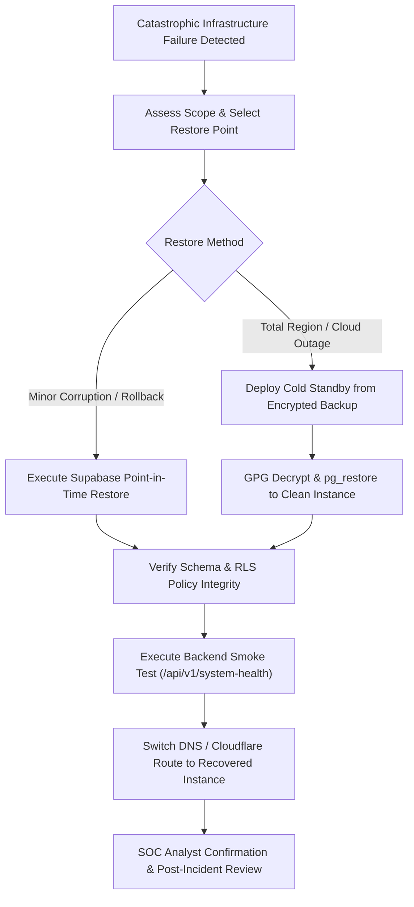

# CyberShield Database Backup & Disaster Recovery Strategy

---

## 1. Objectives & Service Level Commitments
In compliance with SOC 2 Type II and ISO 27001 requirements for business continuity:

- **Recovery Point Objective (RPO)**: **< 1 Hour**
  - Continuous Write-Ahead Log (WAL) archiving ensures maximum data loss window during catastrophic infrastructure failure is under 60 minutes.
- **Recovery Time Objective (RTO)**: **< 30 Minutes**
  - Rapid recovery scripts and automated standby provisioning restore full API functionality within 30 minutes.

---

## 2. Backup Architecture & Automated Schedules

### A. Tier 1: Continuous WAL Archiving & Point-In-Time Recovery (PITR)
- **Engine**: Supabase Managed PostgreSQL WAL Archiving.
- **Retention Window**: 30 days rolling.
- **Capability**: Restore the database to any millisecond within the 30-day window, mitigating accidental table drops or malicious data tampering.

### B. Tier 2: Automated Daily Encrypted Logical Snapshots (`pg_dump`)
- **Schedule**: Every day at 02:00 UTC (during lowest SOC operational traffic).
- **Format**: Custom compressed PostgreSQL format (`pg_dump -Fc`).
- **Encryption**: AES-256 encrypted using GPG keys before offsite transfer.
- **Destination**: Read-restricted, air-gapped S3 bucket with Object Lock (WORM - Write Once, Read Many).

```bash
#!/usr/bin/env bash
# Automated Daily Backup Script: scripts/backup_db.sh
set -eo pipefail

TIMESTAMP=$(date -u +"%Y%m%d_%H%M%SZ")
BACKUP_DIR="/var/backups/cybershield"
FILENAME="cybershield_backup_${TIMESTAMP}.dump"
ENCRYPTED_FILE="${FILENAME}.gpg"

echo "[$(date -u)] Starting database backup..."
pg_dump -Fc -h "$DB_HOST" -p "$DB_PORT" -U "$DB_USER" -d "$DB_NAME" -f "${BACKUP_DIR}/${FILENAME}"

# Verify backup file size
if [ ! -s "${BACKUP_DIR}/${FILENAME}" ]; then
    echo "[ERROR] Database backup failed: Output file empty." >&2
    exit 1
fi

# Encrypt backup archive with public recipient key
gpg --batch --yes --encrypt --recipient ops-backup@cybershield.io -o "${BACKUP_DIR}/${ENCRYPTED_FILE}" "${BACKUP_DIR}/${FILENAME}"
rm "${BACKUP_DIR}/${FILENAME}"

# Transfer to air-gapped offsite storage
aws s3 cp "${BACKUP_DIR}/${ENCRYPTED_FILE}" "s3://${BACKUP_S3_BUCKET}/db-backups/${ENCRYPTED_FILE}" --sse aws:kms

echo "[$(date -u)] Backup completed and transferred successfully: ${ENCRYPTED_FILE}"
```

---

## 3. Disaster Recovery Execution Playbook



---

## 4. Migration Rollback Guidance
When database migrations introduce regressions or schema discrepancies:

1. **Strict Idempotency**: All migrations in `supabase/migrations/` must be authored with safe, non-destructive statements (`CREATE TABLE IF NOT EXISTS`, `ADD COLUMN IF NOT EXISTS`).
2. **Pre-Migration Snapshot**: Before applying production migrations, an instant snapshot must be triggered via Supabase CLI:
   ```bash
   supabase db dump -f pre_migration_backup.sql
   ```
3. **Rollback Execution**:
   - Revert application container to previous image tag.
   - Execute down migration or apply pre-migration snapshot:
   ```bash
   psql -h "$DB_HOST" -U "$DB_USER" -d "$DB_NAME" -f pre_migration_backup.sql
   ```

---

## 5. Storage Vault Recovery Guidance
Evidence files (packet captures, logs, screenshots) are stored in Supabase Storage with cryptographic SHA-256 integrity digests stored in the PostgreSQL database:

- Every uploaded file's SHA-256 hash is recorded in `evidence_items` table.
- Storage buckets maintain Cross-Region Replication (CRR) to a secondary cloud region.
- Verification audits run weekly to compare storage object hashes against database records.
