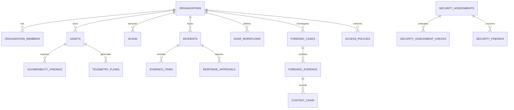

# CyberShield – Database Architecture & Migration Verification
**Document ID:** DB-ARCH-2026-FINAL  
**Database Engine:** PostgreSQL 15 (Supabase Managed / Local Container)  
**Row Level Security (RLS):** Enabled on 100% of multi-tenant tables  

---

## 1. Migration History & Sequential Lineage

CyberShield features 17 non-destructive, sequentially versioned SQL migrations located in `supabase/migrations/`:

| # | Migration File | Sprint | Key Tables Created / Modified |
|---|---|---|---|
| 1 | `20261031_initial_schema.sql` | 1 | `profiles`, `organizations`, `user_roles` |
| 2 | `20261031_sprint2_auth_and_database.sql` | 2 | `audit_logs`, `sessions`, `api_keys` |
| 3 | `20261031_sprint3_asset_management.sql` | 3 | `assets`, `asset_tags`, `asset_services` |
| 4 | `20261031_sprint5_authorized_discovery.sql` | 5 | `scan_scopes`, `scans`, `scan_results` |
| 5 | `20261031_sprint6_vulnerability_engine.sql` | 6 | `vulnerability_findings`, `remediation_tasks` |
| 6 | `20261031_sprint7_threat_intel_monitoring.sql` | 7 | `threat_indicators`, `threat_feeds`, `security_events` |
| 7 | `20261031_sprint8_incident_response.sql` | 8 | `incidents`, `playbooks`, `evidence_items`, `response_approvals` |
| 8 | `20261031_sprint9_ai_analytics.sql` | 9 | `ai_conversations`, `ai_messages`, `analytics_snapshots` |
| 9 | `20261031_sprint10_enterprise_saas.sql` | 10 | `organization_subscriptions`, `organization_invitations`, `subscription_plans` |
| 10 | `20261102_sprint11_reporting_compliance.sql` | 11 | `compliance_frameworks`, `compliance_controls`, `reports` |
| 11 | `20261102_sprint12_network_monitoring.sql` | 12 | `telemetry_flows`, `monitoring_agents`, `network_anomalies` |
| 12 | `20261102_sprint13_soar_engine.sql` | 13 | `soar_workflows`, `soar_executions`, `soar_approvals` |
| 13 | `20261102_sprint14_ai_threat_intelligence.sql` | 14 | `ai_threat_models`, `ai_detection_rules`, `ai_investigations` |
| 14 | `20261102_sprint15_enterprise_integrations.sql` | 15 | `integrations`, `webhook_endpoints`, `integration_delivery_logs` |
| 15 | `20261102_sprint17_threat_hunting_forensics.sql` | 17 | `threat_hunting_cases`, `forensic_cases`, `forensic_evidence`, `custody_chain` |
| 16 | `20261102_sprint18_enterprise_identity_sso_mfa.sql` | 18 | `identity_providers`, `access_policies`, `mfa_factors`, `session_metadata` |
| 17 | `20261104_sprint19_security_validation_assurance.sql` | 19 | `security_assessments`, `security_test_runs`, `security_findings`, `security_exceptions` |

---

## 2. Core Entity Relationships (ERD)



---

## 3. Multi-Tenant Row Level Security (RLS) Rules

Every operational table includes:
1. `organization_id UUID NOT NULL REFERENCES organizations(id) ON DELETE CASCADE`.
2. Mandatory index on `organization_id` to prevent table scans during tenant lookups.
3. RLS policy enforcing membership:
```sql
CREATE POLICY "Tenant isolation policy" ON operational_table
    FOR ALL
    USING (
        organization_id IN (
            SELECT organization_id FROM organization_members
            WHERE user_id = auth.uid()
        )
    );
```
4. `created_at` and `updated_at` TIMESTAMPTZ default `NOW()` columns.
