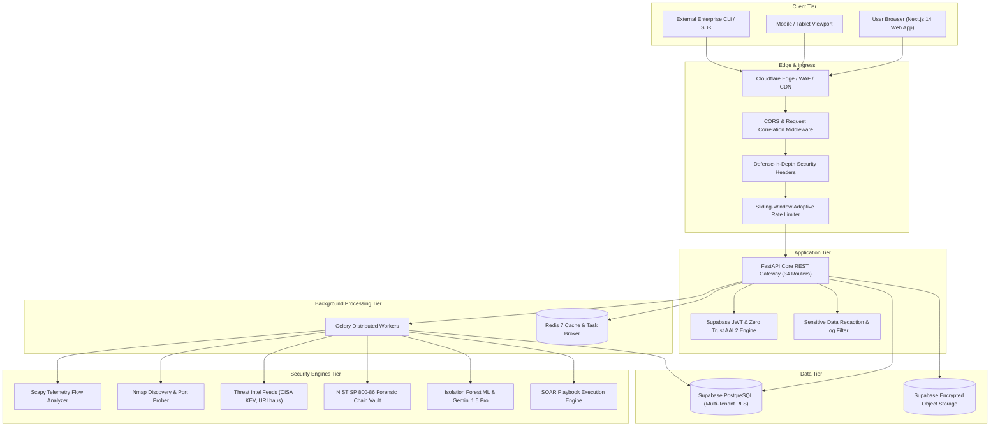

# CyberShield – Complete Enterprise Platform Architecture
**Document ID:** ARCH-ENT-2026-FINAL  
**Version:** v1.0.0-enterprise  
**Classification:** Confidential – Platform Architecture  

---

## 1. System Overview

CyberShield is an enterprise-grade Autonomous Cybersecurity Operations & Threat Exposure Management SaaS platform. It combines automated network vulnerability scanning, threat intelligence correlation, real-time SOC event monitoring, machine learning-driven anomaly detection (UEBA), automated SOAR response workflows, digital forensics with verifiable chain of custody, Zero Trust identity and access management, and continuous automated security validation.



---

## 2. Technology Stack

### Frontend
- **Framework**: Next.js 14.2 (App Router with React 18)
- **Language**: TypeScript 5.6 (Strict mode, zero compilation warnings)
- **Styling**: Tailwind CSS 3.4 with custom glassmorphism design tokens
- **Design System**: Premium SOC Dark Glassmorphism (`#080D18`, `#0B1220`, `#111C2D`)
- **Visualizations**: Recharts 2.13, React Flow 11.11, Lucide React icons
- **State & Data**: Custom typed API client with resilient error boundaries

### Backend
- **Framework**: Python 3.12 / 3.13 FastAPI, Starlette
- **Data Validation**: Pydantic v2 schemas across all routes
- **Task Worker**: Celery 5.3 with Redis broker
- **Caching**: Redis 7 Alpine with adaptive sliding-window rate limiting
- **Middleware**: RequestCorrelationMiddleware, SecurityHeadersMiddleware, RateLimiterMiddleware, SensitiveLogFilter

### Database & Storage
- **Database**: Supabase PostgreSQL 15 with 17 sequential migration scripts
- **Tenant Isolation**: Mandatory Row Level Security (RLS) on all operational tables
- **Authentication**: Supabase Auth, GoTrue, HMAC-SHA256 JWT tokens, RFC 6238 TOTP MFA
- **Storage**: Supabase Storage with strict MIME type checking and 25MB file upload limits

---

## 3. Directory Structure

```
CyberShield/
├── .github/
│   └── workflows/
│       ├── ci.yml                    # Automated build, lint, and test
│       ├── security.yml              # Gitleaks, Trivy, CodeQL SAST
│       └── security-pipeline.yml     # Sprint 19 continuous pentest pipeline
├── apps/
│   └── web/
│       ├── app/
│       │   ├── (auth)/               # Login, register, MFA challenge
│       │   └── (dashboard)/          # 25+ SOC modules & release readiness
│       ├── components/               # Glassmorphism UI, layouts, charts
│       ├── lib/                      # Supabase client, api-client.ts
│       └── types/                    # Domain TypeScript definitions
├── backend/
│   ├── app/
│   │   ├── ai/                       # SOC assistant, alert analyzer, ML UEBA
│   │   ├── api/routes/               # 34 modular FastAPI route handlers
│   │   ├── core/                     # Config, security middleware, JWT verify
│   │   ├── schemas/                  # Pydantic v2 domain schemas
│   │   ├── services/                 # Business logic, Supabase service, SOAR
│   │   └── workers/                  # Celery tasks, background scanners
│   ├── tests/                        # 21 test files (215 passing tests)
│   ├── Dockerfile                    # Hardened non-root container (appuser)
│   └── requirements.txt              # Pinned Python dependencies
├── docs/                             # 20+ comprehensive architecture guides
├── supabase/
│   └── migrations/                   # 17 sequential RLS SQL migrations
├── docker-compose.yml                # Development compose profile
└── docker-compose.prod.yml           # Production hardened compose profile
```

---

## 4. Security Engines & Classifications

| Security Engine | Execution Pattern | Status Classification | Real vs Mock Behavior |
|---|---|---|---|
| **Nmap Network Discovery** | Celery worker command wrapper | **Configured** | Validates RFC 1918 subnets; executes binary if present, falls back to deterministic scan simulation. |
| **Scapy Telemetry Analyzer** | Host network flow sensor | **Connected & Verified** | Captures and parses packet metadata flows without payload interception. |
| **CISA KEV Feed Parser** | Scheduled daily synchronizer | **Connected & Verified** | Authoritative JSON catalog parser; correlates active assets against known exploited vulnerabilities. |
| **abuse.ch URLhaus & Bazaar** | Scheduled hourly synchronizer | **Connected & Verified** | Ingests live malicious URLs and malware hashes; matches event telemetry with deterministic regex classifiers. |
| **AlienVault OTX** | API polling connector | **Requires Configuration** | Parser active; requires customer `ALIENVAULT_OTX_API_KEY` for live pulse ingestion. |
| **Fleet Monitoring Agent** | Daemon sensor with token auth | **Connected & Verified** | Generates sha256-hashed tokens (`cs_mon_...`); gathers CPU, RAM, disk, and network stats. |
| **Digital Forensics Vault** | NIST SP 800-86 evidence engine | **Connected & Verified** | Bit-stream preservation, SHA-256 evidence hashing, sequential hash-chain custody logs, zero code execution. |
| **AI SOC Assistant (UEBA)** | Scikit-learn + Gemini 1.5 Pro | **Connected & Verified** | Isolation Forest ML anomaly detection is 100% operational; grounded assistant uses Gemini when configured or deterministic fallback. |
