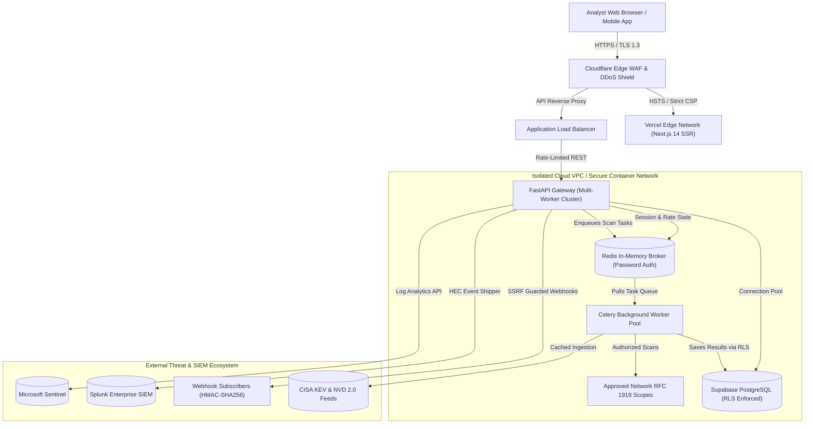
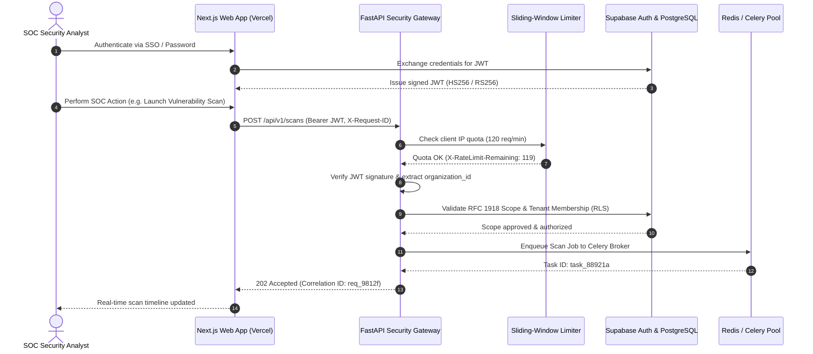

# CyberShield Enterprise Production Architecture

---

## 1. Executive Summary & Design Principles
CyberShield is architected as a high-security, multi-tenant cybersecurity operations and threat intelligence platform designed for 24/7 Security Operations Centers (SOC). 

### Core Architectural Principles
1. **Zero-Trust Network Model**: All internal and external network calls enforce mutual authentication, parameter sanitization, and cryptographic payload verification.
2. **Strict Multi-Tenant Isolation**: Enforced at the PostgreSQL storage engine layer using Supabase Row Level Security (RLS) bound to authenticated tenant organization IDs.
3. **Stateless API Gateway**: The Python FastAPI central gateway is horizontally scalable, state-independent, and delegates background scans to asynchronous Celery workers.
4. **Least-Privilege Containerization**: Containers execute with non-root system users (`UID/GID 1001`), dropped Linux capabilities, read-only root filesystems where practical, and resource quotas.
5. **Defense-in-Depth DevSecOps**: Continuous static analysis (CodeQL), secret detection (Gitleaks), container vulnerability scanning (Trivy), and automated dependency management (Dependabot).

---

## 2. Component Dependency Architecture

---

## 3. Service Communication Sequence

---

## 4. Environment Profiles & Configuration Matrix

| Variable / Setting | Development | Staging | Production |
| :--- | :--- | :--- | :--- |
| `ENVIRONMENT` | `development` | `staging` | `production` |
| `DEBUG` | `True` | `False` | `False` (Enforced on startup) |
| `SECRET_KEY` | Dev placeholder allowed | Unique 256-bit key | Min 32 chars high-entropy secret |
| `ALLOWED_ORIGINS` | `http://localhost:3000` | Staging domains | Exact production FQDNs only |
| `SUPABASE_URL` | Local / Dev project | Staging project | Production cluster URL |
| `RATE_LIMIT_ENABLED` | `True` (whitelisted tests) | `True` (120 req/min) | `True` (120 req/min, 15 auth/min) |
| `SECURITY_HEADERS` | Enabled | Enabled | Enabled with strict HSTS preload |
| `CELERY_TASK_EAGER` | `True` (Unit tests) | `False` | `False` (Distributed worker cluster) |

---

## 5. Cloud Deployment Blueprint

### A. Frontend Layer (Next.js on Vercel)
- **Deployment Platform**: Vercel Enterprise or AWS ECS.
- **Routing & SSR**: Next.js App Router with server-side rendering for initial load performance.
- **Static Asset Optimization**: Immutable hashed assets distributed via edge CDN with 1-year cache headers.
- **Content Security Policy**: Script, style, font, and frame restrictions injected on every HTTP response.

### B. Backend Layer (Dockerized FastAPI on AWS ECS / GCP Cloud Run / Linux VM)
- **Base Image**: `python:3.11-slim` running as unprivileged user `appuser` (UID/GID 1001).
- **Process Manager**: `uvicorn` with asynchronous worker threads behind an Application Load Balancer.
- **Auto-Scaling Criteria**: CPU utilization > 70% or average latency > 250ms.
- **Zero-Downtime Rolling Updates**: Blue/Green deployment with `/api/v1/health` and `/api/v1/system-health/ping` probes.

### C. Data & Broker Layer (Supabase & Redis)
- **Database**: Managed PostgreSQL on Supabase with dedicated compute, automated daily snapshots, and WAL point-in-time recovery.
- **Message Broker**: Redis 7.2 with password authentication, in-memory LRU eviction, and isolated internal container networking (`cybershield-internal-net`).
