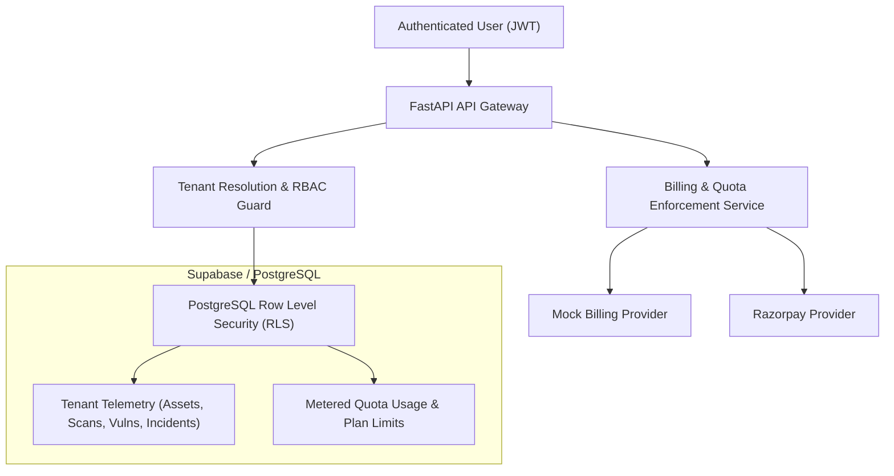

# CyberShield – Sprint 10 Architecture & SaaS Implementation
## Enterprise SaaS, Multi-Tenancy, Centralized RBAC & Subscription Management

---

### 1. Executive Summary

Sprint 10 elevates **CyberShield** from a multi-user SOC application to a complete **Enterprise Multi-Tenant SaaS Platform**. It provides:
1. **Multi-Tenant Organization Management**: Strict tenant isolation enforced at the PostgreSQL Row Level Security (RLS) layer and validated in FastAPI route dependencies.
2. **Centralized Role-Based Access Control (RBAC)**: Strict role tiers (`OWNER`, `ADMIN`, `ANALYST`, `VIEWER`) with built-in protections against orphaned organizations (cannot remove or demote the last owner).
3. **Team Invitations & Seat Quotas**: Secure token-based invitation workflows with 7-day expirations and automatic seat quota guards.
4. **Subscription Plans & Metered Billing Engine**: 3-tier subscription model (`Free Starter`, `Professional SOC`, `Enterprise Defense`) with quota enforcement for assets, team seats, monthly scans, and AI SOC consultations, backed by a pluggable billing provider (Mock & Razorpay).
5. **Programmatic API Key Management**: Scoped API credentials with SHA-256 cryptographic hashing, prefix formatting (`cs_live_...`), and one-time secret reveals.
6. **Platform Admin Control Center**: A dedicated administrative dashboard strictly segregated from tenant owner roles for global health monitoring, cross-tenant auditing, and organization workspace suspension/reactivation.

---

### 2. Multi-Tenant Architecture & Data Isolation



#### Row Level Security (RLS) & Tenant Verification:
- All API requests resolve the targeted tenant workspace using `_resolve_org`.
- Untrusted client parameters (`org_id`) are verified against `organization_members` before executing queries.
- Organization suspension immediately halts discovery scans and prevents mutation operations.

---

### 3. Subscription Tiers & Resource Quotas

| Plan Code | Plan Name | Monthly Price | Max Assets | Analyst Seats | Monthly Scans | AI Consultations | Advanced Features |
| :--- | :--- | :--- | :--- | :--- | :--- | :--- | :--- |
| **FREE** | Free Starter | \$0 / mo | 25 | 3 | 10 | 50 | Basic telemetry |
| **PROFESSIONAL** | Professional SOC | \$199 / mo | 250 | 10 | 100 | 1,000 | Threat Intel, ATT&CK, Playbooks |
| **ENTERPRISE** | Enterprise Defense | \$799 / mo | 2,000 | 50 | 1,000 | 10,000 | Custom playbooks, Dedicated assistance |

#### Quota Enforcement (`QuotaEnforcementService`):
- **Assets Limit**: Evaluated before importing or synchronizing newly discovered network hosts.
- **Member Limit**: Evaluated before generating new email invitations.
- **Monthly Scans Limit**: Evaluated before queuing Celery discovery or vulnerability scan tasks.
- **AI Requests Limit**: Evaluated prior to routing inference requests to AI providers.

---

### 4. API Key Security & Lifecycle

1. **Generation**: Raw keys are generated using cryptographically secure random bytes: `cs_live_<secret>`.
2. **One-Time Display**: Raw keys are returned **strictly once** upon generation. They are never stored in plain text or retrievable again.
3. **Storage**: Only the SHA-256 hash (`key_hash`) and a truncated display prefix (`key_prefix`, e.g., `cs_live_9f8a...`) are persisted.
4. **Rotation**: Atomically revokes the current secret and generates a replacement token without losing descriptive tags or assigned scopes.

---

### 5. Platform Admin Control Center

To guarantee strict separation of concerns, **Platform Admin** privileges are decoupled from tenant organization roles:
- Tenant **Owners** manage assets, billing, and team members **only within their organization**.
- **Platform Admins** manage global cluster health, review all registered tenants, and can suspend or reactivate workspaces under compliance mandates.

---

### 6. API Route Catalog

#### Organizations (`/api/v1/organizations`)
- `GET /api/v1/organizations`: List authenticated user's organization memberships.
- `POST /api/v1/organizations`: Create a new tenant workspace (creator assigned as Owner).
- `GET /api/v1/organizations/{org_id}`: Retrieve workspace profile and active plan.
- `PATCH /api/v1/organizations/{org_id}`: Update organization metadata (Owner/Admin).
- `POST /api/v1/organizations/{org_id}/switch`: Switch active tenant context.

#### Team Management (`/api/v1/team`)
- `GET /api/v1/team/members`: List team members and active roles.
- `PATCH /api/v1/team/members/{member_id}/role`: Update member role (guards against last-owner demotion).
- `DELETE /api/v1/team/members/{member_id}`: Remove member (guards against last-owner removal).
- `GET /api/v1/team/invitations`: List pending invitations.
- `POST /api/v1/team/invitations`: Send new invitation (seat quota verified).
- `POST /api/v1/team/invitations/{inv_id}/resend`: Refresh invitation token.
- `DELETE /api/v1/team/invitations/{inv_id}`: Revoke pending invitation.

#### Subscriptions & Billing (`/api/v1/subscriptions`)
- `GET /api/v1/subscriptions/plans`: List all available plan tiers and quotas.
- `GET /api/v1/subscriptions/current`: Query active subscription state.
- `POST /api/v1/subscriptions/checkout`: Create upgrade checkout session.
- `POST /api/v1/subscriptions/cancel`: Cancel auto-renewal at period end.
- `GET /api/v1/subscriptions/usage`: Query metered resource consumption vs limits.
- `POST /api/v1/subscriptions/webhook`: Handle verified payment gateway webhooks.

#### API Keys (`/api/v1/api-keys`)
- `GET /api/v1/api-keys`: List active keys (prefix only, hash omitted).
- `POST /api/v1/api-keys`: Create scoped API key (one-time raw secret return).
- `DELETE /api/v1/api-keys/{key_id}`: Revoke active key.
- `POST /api/v1/api-keys/{key_id}/rotate`: Rotate key and issue new credential.

#### Platform Admin (`/api/v1/platform-admin`)
- `GET /api/v1/platform-admin/overview`: Global tenant counts, MRR, and worker health.
- `GET /api/v1/platform-admin/organizations`: Cross-tenant workspace directory.
- `GET /api/v1/platform-admin/users`: Global user directory and memberships.
- `POST /api/v1/platform-admin/organizations/{org_id}/suspend`: Suspend tenant with justification.
- `POST /api/v1/platform-admin/organizations/{org_id}/reactivate`: Reactivate tenant.

---

### 7. Verification & Test Suite

All 97 unit and integration tests across Sprints 1–10 pass cleanly:
```bash
pytest -q
# Output: 97 passed in 2.10s
```
Frontend TypeScript validation:
```bash
cd apps/web && npx tsc --noEmit
# Output: 0 errors (Code 0)
```
