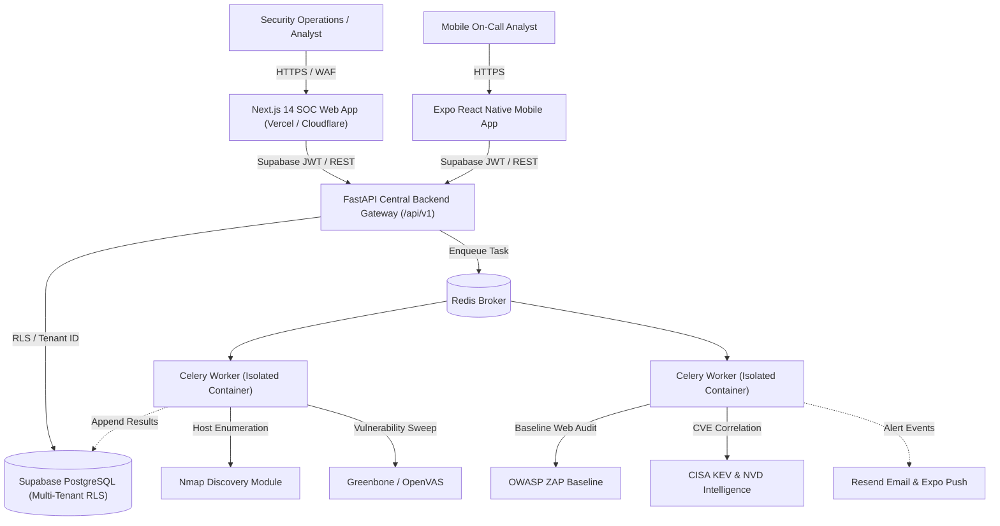

# CyberShield – Architecture Documentation

## 1. System Overview

CyberShield is an enterprise multi-tenant cybersecurity platform delivering automated network discovery, vulnerability assessment, threat intelligence correlation, and Security Operations Center (SOC) incident response workflows.

## 2. Multi-Tenant Isolation & Safety Model

1. **Row Level Security (RLS)**: Every tenant resource (`assets`, `scans`, `findings`, `incidents`, `audit_logs`) belongs to an `organization_id`. Database queries strictly evaluate the authenticated user's organization membership through Supabase RLS.
2. **Strict Scope Authorization**: Scanning engines strictly decline execution against any IP or hostname that does not match an active, tenant-approved `scan_scopes` record.
3. **No Exploitation**: The scanner is non-destructive. It does not perform brute force, shell uploads, persistent implants, or DDoS attacks.
4. **Isolated Celery Workers**: Scanners execute in unprivileged Docker containers isolated from public API ingress.
